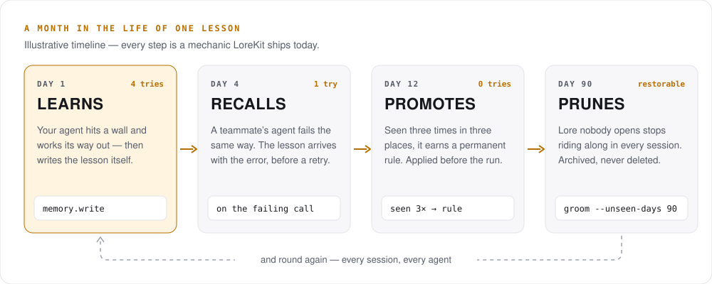
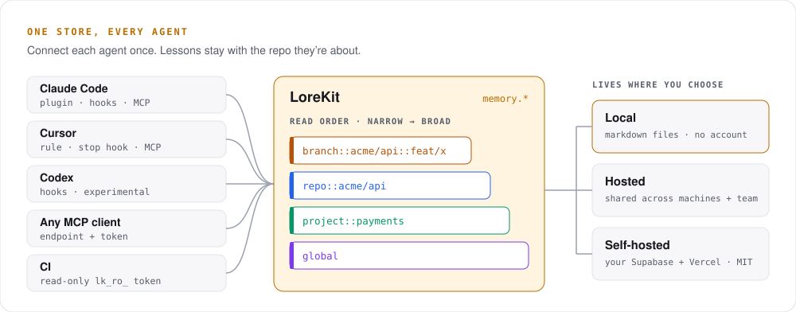

<div align="center">


# [LoreKit](https://lorekit.io)

### Your coding agents forget. LoreKit makes them learn.

When your agent hits a wall and works its way out, it writes down what it
learned — and the next agent to hit that wall gets the lesson **with the
error**, on any machine, in any tool. What keeps recurring becomes a rule.
What nobody uses gets archived.

[](https://github.com/mthines/lorekit/actions/workflows/deploy.yml)
[](https://www.npmjs.com/package/@lorekit/cli)
[](./LICENSE)

[Website](https://lorekit.io) · [Docs](https://lorekit.io/docs/setup) · [Blog](https://lorekit.io/blog) · [Quick start](#quick-start) · [FAQ](#questions-youre-probably-asking)

</div>

```bash
npx @lorekit/cli install
```

Works with **Claude Code** and **Cursor**, Codex (experimental), and any MCP
client. Runs fully offline with no account, or hosted so your whole team
shares one set of lessons. MIT licensed and self-hostable.

<picture>
  <source media="(prefers-color-scheme: dark)" srcset=".github/assets/readme/loop-dark.svg">
  
</picture>

## Design choices

LoreKit makes retrieval deterministic and leaves reasoning to the model.
It stores lessons in scopes (`branch::`, `repo::`, `project::`, `global`; the
most specific copy of a key wins), delivers them through lifecycle hooks and
error matching, counts recurrence so lessons worth promoting into a rule
surface, and archives by measured usage (how often a lesson is chosen versus
delivered). Reasoning over what it delivers is the model's job. Non-goals, by
design:

- No belief graph, and no typed links between memories.
- No confidence scores, and no propagation between memories.
- No contradiction detection, and no invalidation through dependency chains.

The bet: keep memory small, legible, and in the hot path — no structure
precomputed at write time. Beyond catching failures, a skill can use LoreKit
to improve on every run: [self-improving workflows](https://lorekit.io/docs/self-improving-workflows).

## Why not just a CLAUDE.md?

Keep it. A rules file holds what you knew to write down **before** anything
broke. LoreKit captures what your agents find out the hard way — and keeps
sorting it.

| | Rules file (`CLAUDE.md`, `.cursorrules`, …) | LoreKit |
|--|--|--|
| **Who writes it** | You, when you remember to | Your agents, the moment they hit friction |
| **What's in it** | What you predicted would matter | What actually broke — and the fix that worked |
| **What gets loaded** | All of it, every session | What matches: at session start, on each prompt, on the failing call |
| **Over time** | Grows until someone prunes it | Promotes what recurs, archives what nobody uses |

LoreKit is how you find out what has earned a place in your CLAUDE.md.

### How the loop actually runs

Each step is shipped behaviour, not a roadmap item:

- **Learns.** Lifecycle hooks watch the session for friction — errored tool
  calls, a command repeated in a loop — and nudge the agent to write a lesson
  before it stops. Clean sessions stay silent.
- **Recalls.** When a tool call fails, the hook searches your lore with the
  tool name and error text and injects up to three matching lessons *before*
  the agent retries. (Claude Code; Cursor reads lessons through a rule and an
  end-of-turn hook.)
- **Promotes.** A lesson re-learned in later sessions accrues a seen-count;
  session start ranks the most-recurring first, and the
  [Insights](https://lorekit.io/insights) view flags the load-bearing ones to
  promote into a permanent rule.
- **Prunes.** Every lesson delivered costs tokens whether it's used or not.
  LoreKit tracks how often each lesson is actually opened versus merely
  delivered, and retention policies archive what nobody reads — previewed
  first, restorable with one command.

## Quick start

```bash
npx @lorekit/cli install
```

The installer wires the MCP server, three companion skills, and the lifecycle
hooks into your project, and picks up the repo's scope from its git remote.
It then asks for a token — and that's where you pick a path:

<table>
<tr>
<th width="50%">Hosted — share across machines and teammates</th>
<th width="50%">Local — no account, nothing leaves your disk</th>
</tr>
<tr valign="top">
<td>

1. Sign in at [lorekit.io](https://lorekit.io) → **Connect your agent** →
   **Generate new token** (shown once).
2. Paste it when the installer asks.

Free plan: 5,000 active memories, 120 requests a minute.

</td>
<td>

1. Skip the token.
2. Point `.mcp.json` at the CLI's built-in local server and set
   `"mode": "local"` in `.lorekit.json` — see the
   [offline guide](https://lorekit.io/docs/offline).

Lessons are markdown files you can grep, diff, and commit.

</td>
</tr>
</table>

Then check it's wired up:

```bash
npx @lorekit/cli doctor   # connectivity, token permission, detected scopes
```

From then on, every session starts with the lessons that apply to it.

<details>
<summary><b>Claude Code plugin, Claude Code on the web, global install, tab completion</b></summary>

**Claude Code marketplace plugin** — skill + hooks + MCP in one install:

```bash
/plugin marketplace add mthines/lorekit
/plugin install lorekit-memory@lorekit
```

**Claude Code on the web** runs in a fresh clone each session, so add
`--mcp-json` to write a committable, secret-free `.mcp.json` (auth via
`${LOREKIT_TOKEN}`):

```bash
npx @lorekit/cli install --global --mcp-json
```

See the [Claude Code on the web guide](https://lorekit.io/docs/claude-code-web).

**Use the CLI a lot?** Install it globally and drop the `npx` prefix:

```bash
npm install -g @lorekit/cli
lorekit search "flaky test"
lorekit install --completions auto   # zsh / fish tab completion
```

**The companion skills** the installer adds:

- `lorekit-memory` — reads relevant lessons when a task starts, writes one when
  something goes wrong.
- `lorekit-setup` — wires a self-improvement loop into *your own* skills: a
  fast episodic tier that promotes proven lessons into permanent rules, with
  guards that stop a loop reinforcing its own mistakes.
- `lorekit-groom` — tidies a noisy store: merges near-duplicates, lints weak
  lessons, sets expiry. Always proposes a plan before changing anything.

Also shipped in the Claude plugin, but **not** installed by `lorekit install`
(it's a one-time runbook, not everyday agent memory): `lorekit-self-host` — a
slash-only guided deployment walkthrough. Invoke it with `/lorekit-self-host`.

</details>

## One store, every agent

<picture>
  <source media="(prefers-color-scheme: dark)" srcset=".github/assets/readme/store-dark.svg">
  
</picture>

- **Lessons stay with their repo.** Every lesson lands under a scope —
  `branch::`, `repo::`, `project::`, or `global`. Agents read narrowest first,
  so one repo's lore never crowds another's.
  ([scope format](./docs/scope-format.md))
- **One shared set for the team.** Bind `repo::acme/*` to your org and every
  teammate's agent reads and writes the same lessons. CI reads with a
  read-only `lk_ro_` token. Anything unbound stays personal.
  ([organizations](https://lorekit.io/docs/organization))
- **Start local, move up later.** `lorekit migrate --from ~/.lorekit --to remote`
  previews the whole plan before it changes anything — lessons are never
  stranded.

| Tool | How it connects | Status |
|------|-----------------|--------|
| **Claude Code** | Marketplace plugin or CLI: skills + 4 lifecycle hooks + MCP | Supported |
| **Cursor** | A rule + `stop` hook + MCP (three copied files) | Supported |
| **Codex** | Feature-flagged hooks with an `AGENTS.md` fallback | Experimental |
| **Any MCP client** | The endpoint and a Bearer token | Works — no hooks |

All integrations share one zero-dependency hook engine; each host only gets a
thin adapter. See [plugins/](./plugins/README.md).

## Also in the box

- **Learns from your code reviews.** Point a GitHub webhook at a repo and
  review comments become *candidate* lessons. Noise is filtered out, and a
  candidate expires unless it proves useful.
- **Every lesson in plain sight.** The [dashboard](https://lorekit.io) lets you
  browse, search, filter, edit, and archive everything your agents have
  learned — who wrote it and where it applies.
- **Knows what your memory costs.** Insights estimates what your store costs a
  month in tokens and shows the lore that's earning nothing.
- **A real CLI.** `list`, `search`, `show`, `tree`, `diff`, `dedupe`, `lint`,
  `groom`, and more — against either store, with `--json` for scripting.
  ([CLI reference](./docs/cli.md))

<p align="center">
  
  
</p>

## Questions you're probably asking

<details>
<summary><b>Does it read or upload my code?</b></summary>

No. LoreKit doesn't index your codebase. It stores exactly what an agent
writes to it through `memory.write` — short lessons — and nothing else. In
local mode nothing leaves your machine at all.

</details>

<details>
<summary><b>Who can see my lessons on the hosted store?</b></summary>

Only you. Every memory is personal by default — visible only to the user or
token that wrote it. Sharing with a team is opt-in, per scope, through an org.
See [private lore](https://lorekit.io/docs/private).

</details>

<details>
<summary><b>Won't this bloat my context window?</b></summary>

It can surface a lesson you didn't need — that's the honest answer. What
keeps it in check: scopes narrow what an agent sees, recall only injects what
matches, LoreKit measures which lessons are actually opened, and grooming
archives what has stopped earning its place.

</details>

<details>
<summary><b>What does it cost?</b></summary>

Nothing. There is no paid tier yet. The hosted free plan holds 5,000 active
memories at 120 requests a minute. Local mode needs no account, and a
self-hosted instance sets its own limits.

</details>

<details>
<summary><b>What if the hosted service goes away?</b></summary>

The whole stack — MCP server, dashboard, database — is in this repo under MIT,
and deploys to your own Supabase and Vercel projects in about five minutes
([self-hosting guide](./docs/install.md), or the walkthrough at
[lorekit.io/docs/self-host](https://lorekit.io/docs/self-host)). Or skip the hosted store entirely
and keep lessons as markdown in your repo.

</details>

<details>
<summary><b>Does the CLI phone home?</b></summary>

The human-facing CLI commands (`install`, `doctor`, `list`, `search`, …) send
one usage span per run so the maintainers can see which commands get used: the
command name, a few boolean flags, the CLI/runtime/OS version, and the outcome.
No path, token, endpoint, repo, or scope is ever sent
([details](./packages/cli/README.md#usage-telemetry)). Turn it off with `LOREKIT_TELEMETRY=0` or the cross-vendor
`DO_NOT_TRACK=1`, or set `"telemetry.disabled": true` in `.lorekit.json` for a
whole team.

</details>

## The fine print, up front

- **It doesn't make an agent smarter on its own.** If nothing writes a lesson,
  there is nothing to read — which is why the plugins wire lifecycle hooks
  instead of leaving it to the agent's discretion.
- **Error-matched recall is richest on Claude Code.** Cursor has no
  post-failure hook event, so it reads lessons through its rule instead.
- **Codex support is experimental.** Claude Code and Cursor are the supported
  paths.
- **It's young.** LoreKit is actively developed and moves fast — check the
  [release notes](https://github.com/mthines/lorekit/releases) before
  upgrading.

## Documentation

| Guide | What it covers |
|-------|----------------|
| [lorekit.io/docs](https://lorekit.io/docs/setup) | Setup, offline mode, orgs, grooming, Claude Code on the web |
| [docs/mcp-tools.md](./docs/mcp-tools.md) | The `memory.*` tools, with request/response examples |
| [docs/scope-format.md](./docs/scope-format.md) | How scopes work and how agents resolve them |
| [docs/api-tokens.md](./docs/api-tokens.md) | Token types (`lk_rw_` / `lk_ro_` / `lk_wo_`) and CI usage |
| [docs/cli.md](./docs/cli.md) | Every CLI command and flag |
| [docs/install.md](./docs/install.md) | Run your own instance |
| [docs/](./docs/README.md) | Everything else — architecture, limits, observability |

## Contributing

LoreKit is an NX monorepo — MCP server (Deno, Supabase Edge Functions),
dashboard (Next.js), and a zero-dependency CLI. Issues and PRs are welcome;
[DEVELOPMENT.md](./DEVELOPMENT.md) gets you from clone to green checks.

If LoreKit saves your agent a retry or two, a ⭐ helps other developers find it.

## License

[MIT](./LICENSE) © LoreKit contributors.
